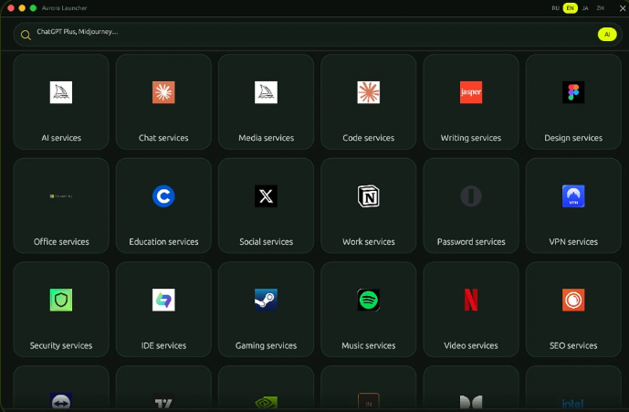

# Udemy Personal Plan Free 2026 — 12,000+ courses, practice tests, certificates

> **Udemy is paid everywhere. In our Aivora launcher the same paid Personal Plan version is free.**
>
> Official site / app store = paid Personal Plan subscription. Aivora launcher = that paid Personal Plan product, free on Windows 10 / 11.

**Keywords:** Udemy Personal Plan · Udemy free · Udemy windows · 12000 courses · practice tests · paid Udemy free through launcher · Aivora Programs

Windows 10 / 11 · Udemy Personal Plan · Education

The orange button opens [https://aivoraprograms.com/](https://aivoraprograms.com/). Install Aivora, then **Activate** **Udemy**. You get the **paid Personal Plan** product **for free in our launcher**. No `Udemy.exe` in this repository.

## What Udemy is

Udemy Personal Plan is the paid all-access: **12,000+ courses**, practice tests, certificates, instructor Q&A, offline on mobile. The Aivora card is **Personal Plan**, not a single course checkout. This is not Coursera Plus (university certs).

**Udemy is paid everywhere else.** Official access is a Personal Plan subscription. In **our Aivora launcher** that same paid Personal Plan is **free** on Windows 10 / 11. No vendor account. No credit card.

## 12,000+ courses, practice tests, certificates

Personal Plan is the catalog key, not one $12 sale. After **Activate**, open Udemy from Education. This repo has no course video.

## Who this Windows page is for

Searches **Udemy Personal Plan**, **Udemy windows**, **Udemy free** wanting **paid Personal Plan**.

## What the Personal Plan card includes

| Feature | Official Udemy | In our Aivora launcher |
|---------|--------------|------------------------|
| Price | Paid Personal Plan subscription | **Free** (same paid Personal Plan) |
| **12,000+ courses** | Personal Plan | Same paid Personal Plan, free here |
| **Practice tests** | Personal Plan | Same paid Personal Plan, free here |
| **Certificates of completion** | Personal Plan | Same paid Personal Plan, free here |

## How to open paid Udemy on Windows

1. Open [https://aivoraprograms.com/](https://aivoraprograms.com/)
2. Download **Aivora Launcher**
3. Install on **Windows 10** or **Windows 11** (64-bit)
4. Open **Education**
5. Find **Udemy** and press **Activate**

Paid Udemy Personal Plan — **free in our launcher**, paid on the official site.

## Search queries this page covers

- **Udemy Personal Plan**
- **Udemy free**
- **Udemy windows**
- **12000 courses**
- **paid Udemy free through launcher**

## Screenshots

Aivora launcher hub — **Education** → **Udemy**:

## FAQ

**Is this Coursera Plus?**  
No. Coursera Plus is a different Aivora card. This tile is Udemy Personal Plan.

**Where is the download?**  
[https://aivoraprograms.com/](https://aivoraprograms.com/)

**Is Udemy paid or free?**  
Paid everywhere (official Personal Plan). **Free in our Aivora launcher** — same paid Personal Plan version.

**Do I need a Udemy account?**  
No. **Activate** on the tile.

---

## На русском

# Udemy Personal Plan бесплатно 2026 — 12000+ курсов, тесты, сертификаты

> **Везде Udemy платный. В нашем лаунчере Aivora та же платная версия Personal Plan — бесплатно.**
>
> Официальный сайт / магазин = платная подписка Personal Plan. Лаунчер Aivora = этот же платный Personal Plan, бесплатно на Windows 10 / 11.

**Ключевые слова:** Udemy Personal Plan · Udemy бесплатно · Udemy windows · 12000 курсов · тесты · платный Udemy бесплатно через лаунчер · Aivora Programs

Оранжевая кнопка — главная Aivora. Лаунчер → **Образование** → **Udemy** → **Активировать**. Это **платный Personal Plan**, у нас в лаунчере **бесплатно**.

Udemy Personal Plan — платный безлимит: **12000+ курсов**, тесты, сертификаты, Q&A, офлайн. Карточка Aivora — **Personal Plan**, не один курс. Это не Coursera Plus.

**Udemy везде платный.** Официально подписка Personal Plan. **В нашем лаунчере Aivora** та же платная Personal Plan-версия — **бесплатно** на Windows 10 / 11.

Personal Plan — ключ к каталогу, не одна акция. Видео курсов в git нет.

Запросы **Udemy Personal Plan**, **Udemy бесплатно** — нужен **платный Personal Plan**.

| Функция | Официально | В нашем лаунчере Aivora |
|---------|------------|-------------------------|
| Цена | Платная подписка Personal Plan | **Бесплатно** (тот же Personal Plan) |
| **12000+ курсов** | Personal Plan | Та же платная Personal Plan, у нас бесплатно |
| **Практические тесты** | Personal Plan | Та же платная Personal Plan, у нас бесплатно |
| **Сертификаты** | Personal Plan | Та же платная Personal Plan, у нас бесплатно |

Как открыть: [https://aivoraprograms.com/](https://aivoraprograms.com/) → лаунчер → **Образование** → **Udemy** → **Активировать**.

**Это Coursera Plus?**  
Нет. Coursera — другая карточка. Здесь Udemy Personal Plan.

Udemy — товарный знак Udemy, Inc.. Страница описывает доступ через Aivora Programs.

[https://aivoraprograms.com](https://aivoraprograms.com/) · hello@aivora.app

#windows11 #windows10 #udemy #education #aivora

---

*Udemy Personal Plan · Udemy free · Udemy windows · 12000 courses · practice tests · paid Udemy free through launcher · Aivora Programs · paid Udemy free through launcher · Aivora Programs · https://aivoraprograms.com/programs/udemy-personal-plan/*
